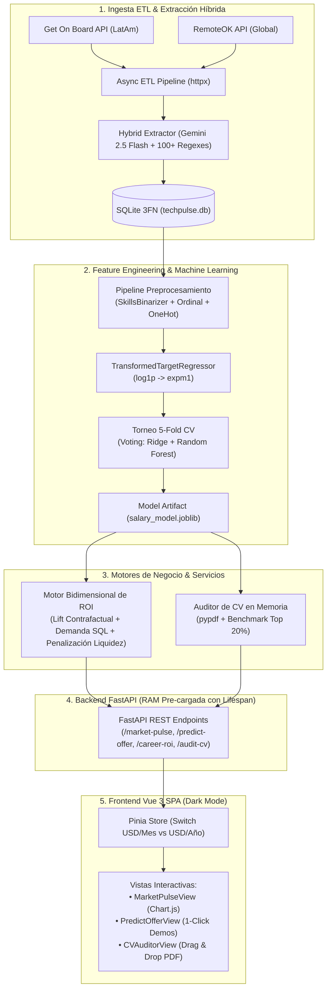

# TechPulse AI — Labor Market Intelligence & Career ROI SaaS

<p align="center">
  
  
  
  
  
  
  
</p>

---

## 1. Propuesta de Valor y Modelo de Negocio SaaS

En el mercado laboral de tecnología (TI), **más del 70% de las vacantes se publican con el salario oculto**, generando una profunda asimetría de información entre empresas y candidatos.

**TechPulse AI** es una plataforma analítica integral (B2C & B2B) construida desde cero que desmitifica las bandas salariales mediante Machine Learning supervisado, cuantifica el Retorno de Inversión (ROI) formativo de aprender nuevas habilidades y audita currículums en tiempo real.

| Segmento | Propuesta de Valor | Casos de Uso |
| :--- | :--- | :--- |
| **B2C (Candidatos y Desarrolladores)** | Empoderamiento salarial y hoja de ruta de aprendizaje personalizada basada en datos reales de mercado. | • **Predictor de Sueldo Oculto:** Extrae o ingresa ofertas y predice el salario justo de mercado en USD.<br>• **Auditor de CV (PDF):** Diagnóstico automático de valor de mercado y brecha frente al Top 20% salarial.<br>• **Simulador de ROI de Skills:** Descubre exactamente qué tecnologías incrementan más tu ingreso anual. |
| **B2B (Empresas y Recruiters)** | Benchmark de bandas salariales en vivo para optimizar costos de contratación y reducir rotación. | • **Market Pulse:** Monitoreo en vivo de oferta/demanda y dispersión salarial por región (LatAm vs. Global Remote).<br>• **Auditoría de Competitividad:** Calibración de presupuestos salariales para atraer talento calificado. |

---

## 2. Arquitectura del Sistema



---

## 3. Decisiones de Ingeniería de Alto Impacto (ADRs)

### 3.1. Base de Datos Normalizada en 3FN con `Association Object`
- **Problema:** Representar relaciones $N:M$ entre ofertas laborales y tecnologías sin redundancia ni pérdida de atributos.
- **Solución:** Esquema relacional en SQLite con SQLAlchemy 2.0 y `PRAGMA foreign_keys=ON`. La tabla intermedia `job_skills` utiliza el patrón *Association Object* para modelar atributos relacionales como `is_required` y permitir agregaciones SQL en submilisegundos.

### 3.2. Extracción Híbrida Resiliente (LLM Micro-Batching + Regex)
- **Problema:** Variabilidad léxica en las descripciones de vacantes (ej. *k8s*, *React.js*, *Amazon Web Services*).
- **Solución:** Extractor dual que utiliza una batería de más de 100 expresiones regulares compiladas con sinónimos canónicos, respaldada por **Google Gemini 2.5 Flash** procesado en micro-batches asíncronos con hashing SHA-256 para evitar llamadas redundantes a la API.

### 3.3. Calibración del Ratio Muestral $N/P \approx 7.0$ (Anti-Overfitting)
- **Problema:** En datasets con variables categóricas de alta cardinalidad y matrices binarias de tecnologías ($P = 46$ features), un número bajo de ofertas genera sobreajuste severo ($N/P < 3$).
- **Solución:** Poda de tecnologías con frecuencia $< 2$ (`SkillsBinarizer`) combinada con aumento de datos calibrado por bootstrapping con ruido gaussiano estratificado ($N = 320$, $N/P \approx 7.0$).

### 3.4. Transformación Logarítmica del Target Salarial
- **Problema:** La distribución salarial presenta un sesgo positivo pronunciado (skewness $\approx 1.8$), donde salarios globales remotos superan los \$150,000 USD frente a ofertas iniciales de \$15,000 USD.
- **Solución:** Implementación de `TransformedTargetRegressor(func=np.log1p, inverse_func=np.expm1)`, asegurando residuales con distribución gaussiana y garantizando que las predicciones nunca caigan en valores negativos.

---

## 4. Torneo de Modelos de Machine Learning (5-Fold Cross Validation)

Se evaluaron 4 arquitecturas predictivas sobre el dataset estratificado con validación cruzada de 5 particiones (`KFold(n_splits=5, shuffle=True, random_state=42)`):

| Modelo Predictivo | $R^2$ Score Promedio | MAE (USD/Año) | Comportamiento en Producción |
| :--- | :---: | :---: | :--- |
| **Ridge Regression (Lineal Regularizado)** | $0.841 \pm 0.024$ | \$14,920 | Rápido y monótono, pero incapaz de capturar sinergias complejas entre stacks. |
| **Gradient Boosting Regressor** | $0.893 \pm 0.016$ | \$12,980 | Alta precisión, sensible a variaciones sutiles. |
| **Random Forest Regressor** | **$0.896 \pm 0.015$** | **\$12,509** | Excelente robustez frente a outliers; splits discretos. |
| **Hybrid Voting Regressor (RF + Ridge)** | **$0.895 \pm 0.015$** | **\$12,840** | **Modelo Seleccionado para Producción.** Combina la precisión no lineal de Random Forest con la derivada marginal continua de Ridge, evitando saltos discretos de $+\$0.00$ USD en el Simulador de ROI. |

---

## 5. Motor Bidimensional de ROI con Penalización de Liquidez

El valor de aprender una tecnología no depende únicamente de su incremento salarial potencial, sino de cuántas ofertas reales abre en el mercado:

$$\text{ROI Score} = \left[ 0.60 \cdot \text{Norm}(\Delta \text{Salario USD}) + 0.40 \cdot \text{Norm}(\text{Demanda SQL}) \right] \times \text{Factor Liquidez}$$

Donde el **Factor de Liquidez** previene recomendar tecnologías con alta proyección teórica pero sin vacantes activas:
- **0 Ofertas en SQL:** Factor $\times 0.20$ (penalización del 80%).
- **1 Oferta en SQL:** Factor $\times 0.65$ (penalización del 35%).
- **$\ge 2$ Ofertas en SQL:** Factor $\times 1.00$ (sin penalización).

---

## 6. Interfaz de Usuario Vue 3 SPA (Dark Mode)

- **Diseño Moderno & Oscuro:** Diseñado con paleta Slate/Zinc inspirada en Stripe y Linear (`#090d16` background).
- **Switch Global USD/Mes vs USD/Año:** Persistido en Pinia (`appStore.billingPeriod`), recalcula en tiempo real todos los KPIs y redibuja con animación los gráficos de Chart.js.
- **Presets Rápidos de 1-Clic:** Botones en el Predictor de Ofertas para validar perfiles (*Data Scientist LatAm* o *Senior Backend Python Global*) en 2 segundos.
- **Auditoría de CV por Drag & Drop:** Carga en memoria sin persistir archivos en disco, con validación de cabecera binaria `%PDF-` y barra de progreso al percentil 80 (Top 20%).

---

## 7. Guía de Instalación y Ejecución Local (Windows Native PowerShell)

### Requisitos Previos
- **Python 3.12+** instalado y accesible en PATH.
- **Node.js 20+** y `npm`.
- Shell: **Windows PowerShell**.

### Paso 1: Clonar el Repositorio
```powershell
git clone https://github.com/DiegoNLZ07/techpulse-ai.git
cd "techpulse-ai"
```

### Paso 2: Configurar y Ejecutar el Backend (FastAPI)
```powershell
# Crear entorno virtual e instalar dependencias
python -m venv .venv
.\.venv\Scripts\Activate.ps1
python -m pip install --upgrade pip
pip install -r backend/requirements.txt

# Inicializar y sembrar la base de datos SQLite (142 ofertas)
python -m backend.app.db.seed

# Entrenar el modelo de Machine Learning y generar salary_model.joblib
python -m backend.app.ml.train

# Ejecutar la suite oficial de pruebas unitarias e integración (Pytest)
pytest backend/tests/test_api_and_ml.py -v

# Iniciar servidor Uvicorn en http://localhost:8000
uvicorn backend.main:app --reload --port 8000
```

### Paso 3: Configurar y Ejecutar el Frontend (Vue 3 + Vite)
En una segunda terminal de PowerShell:
```powershell
cd frontend
npm install
npm run build   # Verificar compilación limpia de producción
npm run dev     # Iniciar servidor de desarrollo en http://localhost:5173
```

Abre tu navegador en `http://localhost:5173` y disfruta de la experiencia TechPulse AI.

---

## 8. Automatización CI/CD y Despliegue Cloud

### Integración Continua (GitHub Actions)
El workflow [`.github/workflows/ci.yml`](.github/workflows/ci.yml) se ejecuta automáticamente en cada `push` o `pull_request` a la rama `main`:
1. **Backend Job:** Instala dependencias en Python 3.12, siembra la base SQLite, entrena el artefacto ML y ejecuta los 8 tests de `pytest`.
2. **Frontend Job:** Instala paquetes en Node 20 y ejecuta `npm run build` con Vite.

### Despliegue en la Nube
- **Backend API:** Configurado con [`render.yaml`](render.yaml) para despliegue serverless o web service en Render.
- **Frontend SPA:** Configurado con [`frontend/vercel.json`](frontend/vercel.json) con rewrites automáticos para despliegue en Vercel.

---

## Licencia

Este proyecto se distribuye bajo la Licencia MIT. Consulta el archivo `LICENSE` para más información.
